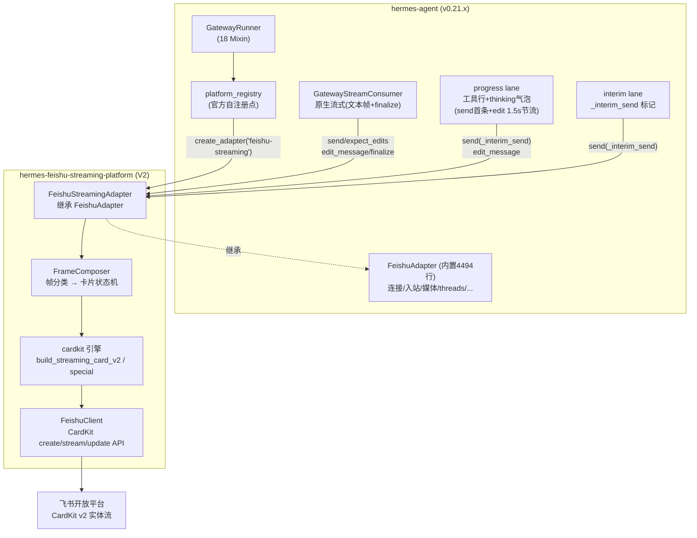
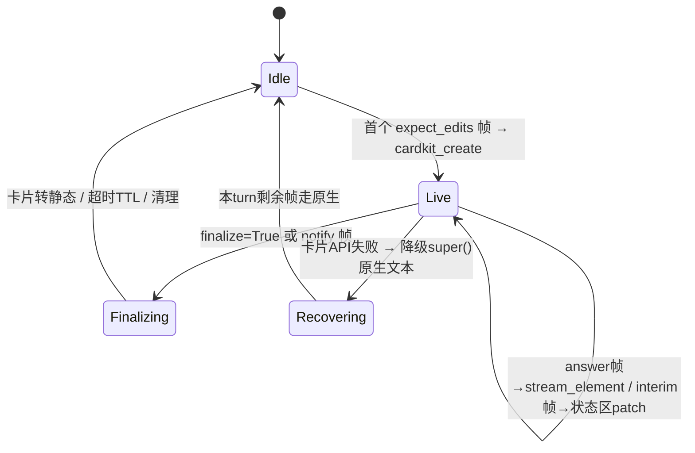

# DESIGN.md — hermes-feishu-streaming-platform v2.0.0

> V2.0.0 是一次彻底重构：插件形态从「standalone 运行时补丁（monkey-patch）」变为「正规 platform 插件」。
> 本文档只描述 V2 架构，不含任何 V1 历史内容。

---

## 1. 项目概述

| 项 | 内容 |
|---|---|
| 名称 | hermes-feishu-streaming-platform（平台名 `feishu-streaming`） |
| 目标 | 以继承 hermes 内置 FeishuAdapter 的方式，提供飞书 CardKit 流式卡片体验，**零 monkey-patch**，完美替代「内置 feishu 平台 + V1 流式插件」两个组件 |
| 技术栈 | Python 3.11+ / lark-oapi ≥1.6.4 / hermes-agent ≥0.21 平台插件协议（plugin.yaml `kind: platform`） |
| 交付 | Gitee `refactor/v2.0.0` 分支；安装后在 gateway 配置中将 platform 名从 `feishu` 切换为 `feishu-streaming` 即启用 |

## 2. 架构总览



**核心思想**：hermes 对飞书的一切出站流量（回答流、工具进度、思考气泡、interim 播报、cron/后台投递）最终都汇入适配器的 `send()` 与 `edit_message()` 两个入口，且每条通道都带可识别标记（见 §4）。V2 在这两个入口做**帧分类**，把帧重组为一张 CardKit 流式卡片的实体更新——这就是「不打钩子也能拿到全部内容」的架构依据。

## 3. 能力继承矩阵

V2 通过 `class FeishuStreamingAdapter(FeishuAdapter)` 继承内置平台，**内置能力零损失**，仅重写出站语义层：

| 内置 FeishuAdapter 能力 | V2 处置 |
|---|---|
| WebSocket 长连接 / webhook 双模式、重连、多路复用循环隔离、SDK 懒加载 | 继承，不改 |
| 入站事件归一化（post/interactive/合并转发/分享群/mention 映射） | 继承，不改 |
| 群 @ 门控、DM 配对、threads、机器人身份、准入诊断 | 继承，不改 |
| `send()` 分块/markdown-post/text 降级/重试 | **重写**：入口分流（卡片路由 or `super()` 原生） |
| `edit_message()` / `delete_message()` | **重写**：finalize 语义映射为卡片定稿 |
| `send_voice / send_document / send_video / send_image(_file) / send_typing` | 继承（媒体走原生气泡，与卡片并存） |
| `send_update_prompt / _send_exec_approval_prompt` | **重写**：卡片化 |
| `send_clarify`（如基类提供则继承重写；否则由 V2 提供） | **重写**：澄清卡片 + 按钮回调 |
| `handle_card_action_event` | **重写**：澄清选择/功能面板按钮 |
| 评论、会议邀请、群规则 | 继承，不改 |
| `get_chat_info / format_message` | 继承，不改 |

| V1 插件能力 | V2 归宿 |
|---|---|
| CardKit 流式卡片（typing 效果、思考折叠、工具面板、footer） | `cardkit/` 引擎原样搬入，由 FrameComposer 驱动 |
| token 级流式控制器（controller/ 2700 行） | **废弃** —— 事件源（agent 回调钩子）不复存在，由帧重组引擎替代 |
| 会话/阶段/线性/文本/工具状态机（state/） | 保留，作为卡片会话状态的存储层 |
| FeishuClient（CardKit create/stream/update API 封装） | 保留，帧重组引擎的底座 |
| /aowen 指令与功能卡片 | 保留，入站拦截改为适配器事件层处理 |
| 澄清卡片、cron 卡片、gateway 卡片 | 保留，接入适配器出站路由 |
| patching/（全部运行时钩子） | **全部删除** —— 零钩子是 V2 的硬性验收标准 |
| config 注入、lark-oapi 版本门槛 | 保留，改造进 platform 注册流程 |

## 4. 四通道帧分类协议（FrameComposer 的输入契约）

hermes v0.21.x 到达适配器出站入口的帧分类依据（全部为官方 metadata / 参数，非私有 hack）：

| 通道 | 到达方式 | 分类标记 | 卡片动作 |
|---|---|---|---|
| answer 流 | `send()` 首条 → `edit_message()` 节流 | `metadata["expect_edits"]=True` | answer 实体流式更新 |
| 流定稿 | `edit_message(..., finalize=True)` / `metadata["notify"]=True` | `finalize` / `notify` | 卡片定稿：折叠思考区、footer 收尾、转静态 |
| 工具进度 + thinking 气泡 | progress lane：`send()` 首条 + `edit_message()` 1.5s 节流 | `metadata["_interim_send"]=True` + 文本模板（`gateway.progress.*` i18n、thinking 前缀） | 状态区实体（工具行/thinking 行追加，防御性解析） |
| interim 播报 | `send()` 带 `_interim_send` | `metadata["_interim_send"]=True` | 状态区 |
| cron / 后台投递 | `send()`（live-adapter lane） | 无流式标记 + 会话状态推断（可选卡片化） | cron 卡片 or 原生文本 |
| 普通消息 | `send()` 无任何标记 | — | `super().send()` 原生路径 |

**状态机**（per `(chat_id, turn)` 键）：



**降级原则**：任何 CardKit API 失败（限流/权限/schema）→ 本 turn 立即降级为 `super()` 原生行为，绝不丢消息。

## 5. 模块设计（V2 包结构）

```
hermes-feishu-streaming-platform/
├── plugin.yaml                 # kind: platform, name: feishu-streaming-platform
├── adapter.py                  # FeishuStreamingAdapter(FeishuAdapter) + register()
├── composer/
│   ├── __init__.py
│   ├── engine.py               # FrameComposer: 帧分类 + 会话状态机 + 节流
│   ├── classify.py             # 帧分类器（metadata/文本模板识别）
│   └── finalize.py             # 定稿/折叠/TTL/清理
├── cardkit/                    # 卡片构建引擎（自 V1 搬入：cards/elements/md/i18n/special）
├── feishu/                     # CardKit API 客户端（自 V1 搬入：client/guard）
├── state/                      # 卡片会话状态（自 V1 搬入：session/linear/phase/text/tooluse）
├── aowen/                      # /aowen 指令与功能卡片（自 V1 搬入）
├── config/                     # 配置读取与默认注入
└── docs/                       # README(说明) / API(接口) / DESIGN(本文档) / TASK_* / TEST_*
```

### 关键类

| 类/函数 | 职责 |
|---|---|
| `FeishuStreamingAdapter` | 继承点。`__init__` 组装 composer；重写 `send / edit_message / send_update_prompt / _send_exec_approval_prompt / handle_card_action_event`；类属性 `SUPPORTS_CARD_STREAMING` 声明 |
| `register(context)` | platform 注册入口：构造适配器工厂、注入默认配置、lark-oapi 版本门槛检查 |
| `FrameComposer.on_send(chat_id, content, reply_to, metadata) -> RouteDecision` | 帧分类 + 路由决策（CARD_NEW / CARD_PATCH / STATUS / NATIVE） |
| `FrameComposer.on_edit(chat_id, message_id, content, finalize)` | 编辑帧处理：卡片实体 patch 或 finalize |
| `CardTurnState` | per-turn 卡片状态：card_id/message_id、answer 缓冲、状态行列表、节流窗口、降级旗标 |
| `ClassifyResult` | `channel ∈ {stream, progress, interim, final, cron, plain}` + 置信度 |

### 帧分类器规则（classify.py）

1. `metadata["_interim_send"]` → interim（若是 progress 首条：文本匹配 progress/thinking 模板 → progress）
2. `metadata["expect_edits"]` → stream
3. `finalize=True` / `metadata["notify"]` → final
4. 其余 → plain（`super()` 原生；cron 内容可配置卡片化）
5. 解析全部防御性：模板不匹配时按 interim 兜底，**永不抛异常、永不丢消息**

## 6. 配置设计

### gateway 侧（用户 config.yaml）

```yaml
gateway:
  platforms:
    - name: feishu-streaming        # 由 feishu 改名即启用 V2
      type: feishu-streaming
      # 原 feishu 的全部配置项不变（app_id/secret/domain/群规则…），继承适配器原样兼容
display:
  thinking_progress: true           # V2 建议：开启思考气泡（progress lane）
  tool_progress: all                # 工具进度显示面
streaming:
  enabled: true                     # 开启 answer 流式
```

### 插件侧（沿用 V1 配置键，`plugins.feishu-streaming.*`）

`panel_expanded / print_strategy / print_step / flush_interval_ms / card_ttl_sec / max_tool_steps / max_reasoning_rounds / footer.fields` —— 注册时自动注入默认值，语义不变。

## 7. 关键风险与兜底

| 风险 | 影响 | 兜底 |
|---|---|---|
| progress 气泡与流卡片是两条独立消息 | 状态区可能落在独立小卡片 | 识别到 progress 帧且有活跃卡片 → patch 主卡状态区；无活跃卡片 → 独立小卡片（可配 `merge_progress: true` 优化） |
| thinking/工具行为渲染后 i18n 文本 | 解析脆弱 | 防御性正则 + 模板不匹配时原文展示；永不失败 |
| `_interim_send` 为 Gateway 内部标记（官方注释允许适配器消费，需在发送前剥离） | 标记泄漏到飞书 | 发送前从 metadata 剥离 `_interim_send`（官方预期行为） |
| CardKit API 限流/失败 | 卡片更新失败 | per-turn 降级旗标 → 本 turn 剩余帧走 `super()` 原生文本 |
| 内置适配器跨版本重构 | 继承面破坏 | 启动时探测重写点方法签名，失配即显式报错（fail-fast）并列出缺失项；平台名独立可回滚（切回 `feishu`） |
| 继承导入路径 `plugins.platforms.feishu.adapter` 变更 | 无法加载 | 多候选路径导入（历史已知路径并集）+ 明确错误指引 |

## 8. 迁移与回滚

- **启用**：安装插件 → gateway 配置 platform 改名 `feishu-streaming` → 重启网关。原 `feishu` 平台保留未删除，随时可切回。
- **回滚**：platform 名改回 `feishu` 即恢复原生行为（卡片会话状态独立存储，无残留）。
- **卸载插件**：移除插件目录即可，无任何运行时残留（零 patch 的直接收益）。
